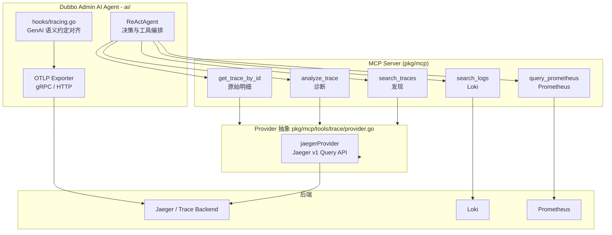
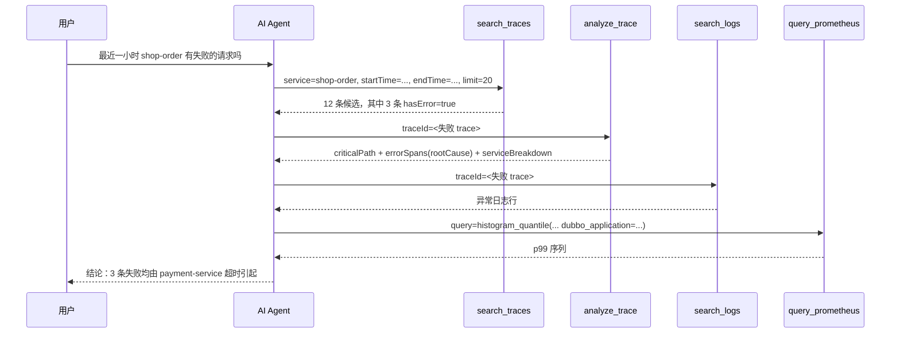

# AI 助手 Trace 观测加强设计

> **实施状态**：Phase 1 已在本分支实现完成（工作区未提交）。
>
> | 交付物 | 状态 |
> | -- | -- |
> | `pkg/mcp/tools/trace/search.go` + `Provider.SearchTraces` + Jaeger v1 查询 API 实现 | 已实现 |
> | `pkg/mcp/tools/trace/analyzer.go`（关键路径 / self time / 服务维度 / 错误归因 / 依赖边） | 已实现 |
> | `pkg/mcp/tools/trace/genai.go`（`gen_ai.*` 识别与归类） | 已实现 |
> | `pkg/mcp/register.go` 注册 `search_traces`、`analyze_trace` | 已实现 |
> | `ai/component/hooks/tracing.go` 对齐语义约定 | 已实现（`gen_ai.agent.name`、span 改名、`error.type` 兜底、`gen_ai.client.operation.exception` 事件） |
| `gen_ai.provider.name` 取值映射（T2） | 已实现（`gemini` → `gcp.gemini`，其余按合法自定义值） |
| `capture_reasoning` 独立策略（T3） | 已实现（与 `capture_content` 正交，默认 `none`） |
> | `server.address` / `server.port`、`gen_ai.response.model` | 未做，见 6.4 与 14 节待确认事项 |
> | Phase 2（metric / trace / log 联动）、Phase 3（跨 trace 聚合、多 provider） | 未开始 |
>
> 下文 2.1 与 6.2、6.4 描述的是 **Phase 1 实施前** 的基线状态，用于说明改造动机与差距来源。

## 1. 背景

2026-10-24 周会（[Discussion #1612](https://github.com/apache/dubbo-admin/discussions/1612)）的 **AI assistant** 章节记录了如下待办：

| task | owner | 等级 | 进度 | issue/discussion | pr |
| -- | -- | -- | -- | -- | -- |
| trace的观测加强 | luoyi | P0 | 待开始 | - | - |

该条目属于 **AI assistant** 章节，而不是 Admin 控制台章节，因此交付物是 **Agent 可用的观测能力**，不是给人看的控制台页面。

对照 2026 路线图 [Discussion #1386](https://github.com/apache/dubbo-admin/discussions/1386)：

- **AI / SRE Agent** 第 7 项「设计Hook系统，接入otel trace」——Agent 自身已通过 `ai/component/hooks/tracing.go` 接入 OTel，但缺少把 trace 数据**回喂给 Agent 自己**的能力。
- **可观测能力** 第 3 项「基于Grafana，探索metric，trace，log的联动」——这是**给人**的 Grafana 联动，与本设计是互补关系。

trace 之所以是 AI 助手当前最大的盲区，是因为 AI 侧的观测能力存在一个结构性缺口：

| 数据类型 | Agent 侧已有工具 | 能否自主发现问题 |
| -- | -- | -- |
| 集群/实例/服务拓扑 | `get_cluster_info`、`search_services`、`get_service_instances` 等 | 能 |
| 日志 | `search_logs`、`analyze_error_logs`、`get_log_capabilities` | 能 |
| 指标 | `query_prometheus`、`query_prometheus_range` | 能 |
| **链路** | **只有 `get_trace_by_id`** | **不能** |

`get_trace_by_id`（`pkg/mcp/tools/trace/tools.go`）要求调用方提供 `traceId`，而 `traceId` 是人肉从日志、告警或 Grafana 里捞出来的。Agent 能自己查日志和指标，却无法自己「找出」一条失败的 trace。因此，只要用户的问题停留在「最近 shop-order 有没有失败的请求」「这个接口为什么变慢」这一层，Agent 就必须先把问题退回给用户索要 traceId，观测能力形同虚设。

## 2. 现状

### 2.1 现有 trace 能力

`pkg/mcp/tools/trace/` 当前包含：

| 文件 | 内容 |
| -- | -- |
| `provider.go` | `Provider` 接口，当前只有 `GetTraceByID(ctx, traceID) (*Trace, error)` 一个方法；`newProvider` 按 `TraceProviderConfig.Type` 分发，`jaeger` 是唯一支持的类型 |
| `tools.go` | `GetTraceByID` handler；`traceIDPattern` 校验 16/32 位十六进制；`providerConfigFromContext` 解析 provider；`Properties()` 返回 MCP input schema |
| `jaeger.go` | Jaeger v1 `/api/traces/{traceID}` 查询；响应归一化与有界裁剪 |
| `model.go` | 后端无关的 `Trace` / `Span` / `Event` 类型（以及本次新增的搜索/分析契约类型） |
| `jaeger_test.go` | 4 个单测：查询与归一化、TraceID 校验、not found、span 裁剪 |

`pkg/mcp/register.go` 只注册了一个 trace 工具 `get_trace_by_id`。`pkg/config/observability/tracing.go` 定义了 `TracingConfig` / `TraceProviderConfig`，`TraceProviderConfig` 带有 `BearerToken`、`Tenant` 两个认证字段，`TracingConfig.Sanitize()` 会把 `BearerToken` 替换为 `config.SanitizedValue`。

### 2.2 邻近工作流及其边界

以下工作流**已经存在或正在被别人推进**，本设计不重复实现，只做衔接：

| 编号 | 标题 | 层次 | 与本设计的关系 |
| -- | -- | -- | -- |
| [#1606](https://github.com/apache/dubbo-admin/issues/1606) / PR [#1607](https://github.com/apache/dubbo-admin/pull/1607)（开放中） | Correlate Jaeger traces with Dubbo RPC metrics | OpenTelemetry Collector OTTL transform + Grafana `tracesToMetrics` | **互补**。它让**人**在 Grafana 里能由 trace 跳到 metric（`dubbo.application` → `application_name`、`dubbo.metric.interface` → `interface`、`rpc.method` → `method`），但它明确不新增 Admin API、Vue 页面和 spanmetrics pipeline，**Agent 依然无法自己发现或分析 trace** |
| [#1537](https://github.com/apache/dubbo-admin/issues/1537) / [#1524](https://github.com/apache/dubbo-admin/issues/1524) | 日志观测与 metric-trace-log 关联 | Grafana 面板 + 关联 | 归属他人。本设计只复用其**数据维度**，不新增 Grafana 面板 |
| PR [#1499](https://github.com/apache/dubbo-admin/pull/1499) | PromQL 与 trace 诊断工具 | MCP 工具 | 已合并，提供 `query_prometheus`、`query_prometheus_range`、`get_trace_by_id`。本设计是它的延伸，**不替换** `get_trace_by_id` |
| PR [#1536](https://github.com/apache/dubbo-admin/pull/1536) | agent hooks 与 OpenTelemetry tracing | Agent 侧 | 已合并，`ai/component/hooks/tracing.go` 已能产出 `gen_ai.*` 属性。本设计负责**对齐语义约定**并让 Agent 能读回自己的 trace |

### 2.3 明确不属于本设计的部分

以下内容属于上述其他 issue 的范围，本设计**不做**：

- 不新增 Admin HTTP API（`pkg/console/` 下无任何新增路由）。
- 不新增或修改 Vue 页面（`ui-vue3/`）。
- 不新增或修改 OpenTelemetry Collector pipeline（OTTL transform、spanmetrics connector 等）。
- 不修改 Grafana datasource / dashboard 配置。
- 不替换或下线已有的 `get_trace_by_id`。

本设计的唯一产出面是：**`pkg/mcp/tools/trace/` 下的新 MCP 工具** + **`ai/component/hooks/tracing.go` 的属性对齐**。

## 3. 目标与非目标

### 3.1 目标

- 让 Agent 能**自主发现** trace：从「服务 + 时间窗 + 条件」出发搜出候选 trace，而不需要人工提供 traceId。
- 让 Agent 能**结构化诊断**一条 trace：关键路径、self time、服务耗时占比、错误归因、依赖边。
- 识别 trace 内部的 **GenAI span**（模型调用、工具调用、Agent span），让 Agent 能回答「这次 LLM 调用花了多少 token、失败在哪一步」。
- 全流程**有界**：沿用 `jaeger.go` 已有的裁剪语义，响应体积、span 数量、属性数量都有上限，超限时显式标记 `truncated`。
- 让 `search_traces` → `analyze_trace` → `search_logs` / `query_prometheus` 形成一条 Agent 可自主执行的调查链路。

### 3.2 非目标

- 不做实时流式 trace 订阅（tail / watch）。
- 不做跨 trace 的聚合统计（错误率趋势、慢调用分布），这属于 Phase 3。
- 不做 trace 写入 / 采样策略配置。
- 不在 MCP 工具输出中回显 prompt / completion 正文、tool 参数体。
- 不做跨 Provider 的统一搜索语义（当前只有 Jaeger）。

## 4. 方案总览



三条并行的观测面：

1. **发现面**：`search_traces` 在 Provider 侧检索，把「一段时间内某服务的失败 trace」变成 Agent 可直接消费的结构化列表。
2. **诊断面**：`analyze_trace` 拉取单条 trace 的 span 明细，在本地做关键路径与错误归因计算，返回结论而不是原始 span 列表。
3. **旁路面**：`search_logs`（可按 `traceId` 过滤）与 `query_prometheus` 用于把诊断结论落到具体日志行和指标上，这条链路已由 PR #1499 与 #1537 铺好。

Agent 自身的 `ai/component/hooks/tracing.go` 通过 OTLP 导出到同一个 Trace Backend，因此 Admin AI 自己的交互也会出现在 `search_traces` 的结果里（`traceKind == "genai"`），这使得「AI 刚才这次对话慢在哪」成为可回答的问题。

## 5. 关键设计

### 5.1 先发现，后分析

这是整个设计的核心判断：**只提供 `analyze_trace` 而不提供 `search_traces` 是无效的**。

一个只持有 traceId 的 Agent 无法开始任何调查——它无法回答「有哪些失败的 trace」「这类失败有多频繁」「是不是新出现的」。真实的问题形态是「最近 shop-order 是不是有问题」，Agent 必须先从「服务 + 时间窗」收敛到一批候选 trace，再逐条深入。

因此两个工具的职责严格分离：

| 工具 | 输入锚点 | 输出体量 | 用途 |
| -- | -- | -- | -- |
| `search_traces` | service（必需）+ 时间窗 + 过滤条件 | 每条 trace 一行摘要，列表有上限 | 缩小范围、发现异常、拿到 traceId |
| `analyze_trace` | traceId（必需） | 单条 trace 的结构化诊断 | 定位原因、量化耗时、归因错误 |

典型 Agent 调用序列：



### 5.2 有界响应与数据最小化

`jaeger.go` 已经确立了一整套裁剪常量，这些语义在 `search` 与 `analysis` 中必须被继承，而不是另起一套：

| 常量 | 值 | 作用 |
| -- | -- | -- |
| `traceQueryTimeout` | 15s | 单次 Provider 请求超时 |
| `maxTraceResponseBytes` | 8 MiB | Provider 响应体上限 |
| `maxTraceErrorBodyBytes` | 4096 | 上游错误体回显上限 |
| `maxTraceSpans` | 500 | 单条 trace 参与分析的 span 上限 |
| `maxTraceRoots` | 50 | 根 span 记录上限 |
| `maxTraceServices` | 100 | 服务名列表上限 |
| `maxSpanAttributes` | 32 | 单 span 属性数上限 |
| `maxSpanEvents` | 10 | 单 span 事件数上限 |
| `maxEventAttributes` | 16 | 单事件属性数上限 |
| `maxAttributeValueBytes` | 512 | 单属性值字节上限（UTF-8 安全截断） |

在此基础上新增两组上限：

- **搜索侧**：`maxSearchTraces`（默认 20，上限 100）限制 `TraceSearchResult.Traces` 的长度；超过则 `Truncated = true`。
- **分析侧**：`maxCriticalPath`（默认 32）、`maxServiceBreakdown`（默认 50）、`maxSlowSpans`（默认 10）、`maxErrorSpans`（默认 20）、`maxDependencyEdges`（默认 50）、`maxGenAICalls`（默认 20）。超出部分丢弃并在 `TraceAnalysis.Truncated` 上置位。

数据最小化上有一条硬规则：**分析器只读取元数据属性，不把 `gen_ai.input.messages`、`gen_ai.output.messages`、`gen_ai.tool.call.arguments`、`gen_ai.tool.call.result` 复制进工具输出**。这些属性在 semconv 中是 `Opt-In` 级别，本身就可能包含 PII；分析器只消费 `gen_ai.request.model`、`gen_ai.usage.*` 这类聚合量。

### 5.3 关键路径与 self time

#### 5.3.1 span 树的构建

输入是 `Trace.Spans`（已由 `normalizeJaegerTrace` 归一化）。构建过程：

1. 建立 `map[spanID]*Span`，遍历 `Trace.Spans`。
2. 父指针取 `Span.ParentSpanID`。`jaeger.go` 的 `parentSpanID(references)` 优先取 `refType == "CHILD_OF"` 的引用，没有则退回第一个引用；两者都为空即为根 span。因此**根 span = `ParentSpanID` 为空的 span**，与 `Trace.RootSpanIDs` 一致。
3. `ParentSpanID` 指向的 span 不在集合内（被 `maxTraceSpans` 裁掉，或采样缺失）时，该 span 退化为**孤儿根**。孤儿根不参与父链计算，但其自身耗时仍计入 `ServiceBreakdown` 与 `SlowSpans`。
4. 解析 `Span.StartTime`（RFC3339Nano）为 `time.Time`。解析失败的 span 退化为叶子节点并跳过 self time 计算，同时把 `TraceAnalysis.Truncated` 置位——时间基准不可信时继续计算会产出误导性的百分比。

#### 5.3.2 self time 的计算

定义：对 span `S`，令 `S` 的子集合为 `C(S)`，`S` 的时间区间为 `[S.start, S.end]`。

```
covered(S) = | ⋃_{c ∈ C(S)} [ max(c.start, S.start), min(c.end, S.end] ] |
self(S)    = S.duration - covered(S)
wait(S)    = covered(S)
```

`covered` 是**子 span 时间区间的并集长度**，而不是子 span duration 之和。这一点是必须的：并发调用（例如同时发起 3 个下游 RPC）的子 span 在时间上重叠，简单求和会让 `self` 变成负数、并让 `ServiceBreakdown.SharePercent` 严重失真。实现上采用区间合并：按 `start` 升序排序子区间，线性扫描合并重叠段，再累加合并后的总长度，复杂度 `O(n log n)`。

边界处理：

- 子 span 完全在父 span 之外（时钟漂移或采样错乱）→ 裁剪到父区间后长度归零，不计入 `covered`。
- 子 span 区间为空或 duration 为 0 → 不计入。
- `self` 计算结果小于 0（父区间被裁剪得更短）→ 置 0，并在该 span 上标记异常。

#### 5.3.3 关键路径的选择

关键路径定义为：**决定端到端时延的那条根→叶链路**。

算法：

1. 在所有根 span 中取 `end` 最大者作为关键路径起点（`end` 相同则取 duration 最大者）。若存在多个根，其余根的子树仍参与 `ServiceBreakdown`、`SlowSpans`、`ErrorSpans`、`Dependencies` 计算，但不进入 `criticalPath`。
2. 从当前节点出发，在其子节点中选取 `end` 最大者（`end` 相同则取 duration 最大者）作为下一跳。理由：`end` 最大的子 span 是父 span 内**最后完成**的活动，它决定了父 span 的完成时刻。
3. 重复直到到达叶子（无子节点）。整条链路即为 `TraceAnalysis.CriticalPath`。
4. 每一跳记录 `CriticalPathEntry`：`spanId`、`serviceName`、`operationName`、`startTime`、`durationMicros`、`selfMicros`、`waitMicros`。

这样得到的链路恰好满足：链路上每一跳的 `end` 都不晚于其父节点的 `end`，且链尾的 `end` 等于 trace 的墙钟终点。链路上的 `selfMicros` 之和是这条 trace 的「不可压缩耗时」。

`SlowSpan` 则按 **self time 降序**取前 N（默认 10），并用 `onCriticalPath` 标记该 span 是否落在关键路径上。self time 排名与 critical path 互补：前者回答「谁自己最慢」，后者回答「请求是怎么被拖长的」。

> 注：`ServiceLatency.SharePercent` 的语义是「该服务的 span duration 之和占 trace 墙钟时长的比例」，分母是墙钟、分子是各 span 时长之和，因此在并发场景下可能超过 100%。这是刻意的「工作量占比」语义而非「时间占比」，调用方需要按此理解，不能把它当成互斥的时间切片。

### 5.4 错误归因与根因检测

**错误 span 判定**：`Span.Error == true` 或 `Span.Status == "ERROR"`。该状态来自 `jaeger.go` 的 `spanStatus(tags)`，它识别三类 tag：`error=true|1`、`otel.status_code=error`、`status.code=error`；`status.code=ok` 映射为 `Status == "OK"`。

**error.type 分类**（按优先级取第一个可用的）：

| 优先级 | 来源 | 说明 |
| -- | -- | -- |
| 1 | span 属性 `error.type` | OTel 稳定属性，semconv 中为 `Conditionally Required`，值域如 `timeout`、`_OTHER` |
| 2 | 事件 `gen_ai.client.operation.exception` 的属性 `exception.type` | semconv 的 GenAI 专用异常事件。本项目服务于 **Agent 循环的 GenAI 执行**，故排在传统异常事件之前 |
| 3 | 事件 `exception` 的属性 `exception.type` | 标准 OTel 异常事件，面向传统 RPC 服务的异常面 |
| 4 | span 属性 `exception.type` | 采集器把异常直接落在 span 属性/标签上时的兜底，事件仍是主来源 |
| 5 | span 属性 `error.message` | **不是 OTel 标准属性**（error registry 只定义 `error.type`），仅在没有任何类型化来源时降级使用 |
| 6 | 常量 `unknown` | 全部缺失 |

`ErrorSpan.ErrorMessage` 按 `gen_ai.client.operation.exception` 事件 → 标准 `exception` 事件 → span 属性 `exception.message` → span 属性 `error.message` 的顺序取值，并受长度上限约束（错误类型 96 字符、错误描述 256 字符）。`error.message` 因为不是标准属性，排在最后。

> 这里刻意区分了两类错误面：**GenAI 执行异常**（模型调用、工具调用失败，走 `gen_ai.client.operation.exception`）与**传统 API 服务异常**（Dubbo RPC 侧的普通异常，走标准 `exception` 事件）。本设计以前者为重点，但分析 Dubbo 链路时后者同样必须能读，故两者都保留、按 GenAI 优先排序。

**token 口径**：`gen_ai.usage.total_tokens` **不是**规范属性，规范只定义了 `gen_ai.usage.input_tokens` 与 `gen_ai.usage.output_tokens`，「总量」是派生概念。因此 `GenAISummary.TotalTokens` **恒等于** `InputTokens + OutputTokens`；若某个非规范 provider 上报了 `gen_ai.usage.total_tokens`，它只作为单次调用明细 `GenAIModelCall.TotalTokens` 的参考值出现，**不参与汇总**（此时明细之和与汇总之和可能不等，属预期）。

**根因检测**：在错误 span 构成的子树中，**没有任何后代 span 也失败**的 span 被标记 `RootCause = true`。反之，一个错误 span 如果其子树中还有失败 span，说明它只是**错误传播**的中间环节，不是根因。`ErrorSpans` 按「最深失败优先」排序，让 Agent 先看到最内层的失败。

这套规则能覆盖 Dubbo 场景中最常见的两种形态：下游超时导致上游 RPC 报错（根因 = 下游 span），以及序列化失败（根因 = 唯一失败的 span）。

### 5.5 服务依赖边

依赖边直接由父子关系导出：对每个 span `c`（其父 `p` 存在于同一 trace 内），产生一条 `p.ServiceName → c.ServiceName` 的边。

聚合规则：

- 按 `(callerService, calleeService)` 去重，`spanCount` 为该对出现的次数。
- `totalMicros` 为该对下所有子 span 的 duration 之和。
- `errorCount` 为该对下 `Error == true` 的子 span 数量。
- 按 `totalMicros` 降序排列。

父子关系天然刻画了**同一条 trace 内的**调用拓扑，是 Dubbo 场景下最可靠的服务依赖信号。跨 trace 的全局拓扑不在本设计范围（属于 roadmap 的「服务拓扑/应用拓扑」条目）。

## 6. GenAI 语义约定对齐

### 6.1 规范来源与状态

权威来源是 OpenTelemetry **semantic conventions for generative AI systems**，本设计对齐的是该仓库的只读 checkout（commit `6fd0d76`），文档位于 `docs/gen-ai/`：

| 规范文件 | 内容 |
| -- | -- |
| `docs/gen-ai/README.md` | 索引 |
| `docs/gen-ai/gen-ai-spans.md` | 模型类 span（chat / embeddings / retrieval / fetch_response / memory / execute_tool） |
| `docs/gen-ai/gen-ai-agent-spans.md` | Agent 类 span（create_agent / invoke_agent / invoke_workflow / plan） |
| `docs/gen-ai/client-inference.md` | 推理（chat）span 与事件 |
| `docs/gen-ai/gen-ai-events.md` | GenAI 事件（`gen_ai.evaluation.result`） |
| `docs/gen-ai/gen-ai-exceptions.md` | GenAI 异常事件 |
| `docs/gen-ai/gen-ai-token-metrics.md` | 推理 token 指标 |

**文档状态**：上述所有文件的标题下方均为 `**Status**: [Development][DocumentStatus]`，即**开发中、尚未稳定**。所有 `gen_ai.*` 属性在 registry 中的 Stability 均为 `Development`；例外是通用属性 `error.type`、`exception.message`、`exception.type`、`exception.stacktrace`、`server.address`、`server.port` 为 `Stable`。

这是一份快速演进中的文档。本设计必须**钉住规范版本**（记录 commit `6fd0d76`），并在每次升级规范时重新核对属性名与枚举值，而不是把属性名写死为「永久正确」。

### 6.2 属性对照表

下表列出 `analyze_trace` 侧识别的属性，以及 Agent 侧 `ai/component/hooks/tracing.go` 需要发出的属性。

| 属性 | 分析器用途 | 规范文件 | Agent 侧现状 | Agent 侧动作 |
| -- | -- | -- | -- | -- |
| `gen_ai.operation.name` | 判定 span 类别（模型调用 / 工具调用 / Agent） | `gen-ai-spans.md`、`gen-ai-agent-spans.md` | 已发：`invoke_agent`、`chat`、`execute_tool` | 保持 |
| `gen_ai.provider.name` | 归类 provider（`openai`、`anthropic`、`aws.bedrock`、`azure.ai.openai`、`gcp.vertex_ai` …） | `gen-ai-spans.md` | 已发，但由 model 字符串按 `/` 切分推导 | **改为白名单映射**，见 6.4 |
| `gen_ai.request.model` | 模型名（模型调用摘要） | `client-inference.md` | 已发（取 model 字符串 `/` 之后部分） | 保持 |
| `gen_ai.response.model` | 实际响应模型 | `gen-ai-spans.md` | 未发 | 可选补充 |
| `gen_ai.usage.input_tokens` / `gen_ai.usage.output_tokens` | token 聚合 | `gen-ai-spans.md`（span 属性，Recommended） | 已发（`EventModelCallEnd`） | 保持 |
| `gen_ai.conversation.id` | 会话归组 | `gen-ai-agent-spans.md` | 已发（取 `SessionID`） | 保持 |
| `gen_ai.agent.name` | Agent 名称 | `gen-ai-agent-spans.md`（invoke_agent 上 Conditionally Required） | **未发** | **Phase 1 必须补** |
| `gen_ai.agent.id` | Agent 稳定标识 | `gen-ai-agent-spans.md` | 未发 | 有稳定标识时补 |
| `gen_ai.tool.name` | 工具名 | `gen-ai-spans.md`（execute_tool 上 **Required**） | 已发 | 保持 |
| `gen_ai.tool.call.id` | 工具调用标识 | `gen-ai-spans.md`（Recommended） | 已发 | 保持 |
| `gen_ai.tool.call.arguments` / `gen_ai.tool.call.result` | 工具入参/结果 | `gen-ai-spans.md`（**Opt-In**） | 已发，受 capture policy 控制 | 保持，分析器**不读取** |
| `gen_ai.input.messages` / `gen_ai.output.messages` | 提示词/回复 | `gen-ai-spans.md`（**Opt-In**） | 已发，受 capture policy 控制 | 保持，分析器**不读取** |
| `error.type` | 错误分类 | `gen-ai-spans.md`（Conditionally Required） | 已发（`state.ErrorType` 非空时） | 保持 |
| `exception.type` / `exception.message` | 异常类型与消息 | `gen-ai-exceptions.md` | 由 `span.RecordError` 产生的标准 `exception` 事件 | 见 6.4 |

### 6.3 genai trace kind 的判定

`TraceSummary.TraceKind` 的语义（见 `model.go`）：**当 trace 中任一 span 携带 `gen_ai.*` 属性时，值为 `"genai"`，否则为空字符串**。

实现上，`pkg/mcp/tools/trace/genai.go` 提供统一识别函数：

- `hasGenAIAttributes(span)`：span 的 `Attributes` 中存在任意以 `gen_ai.` 为前缀的键。
- 分类映射：
  - `gen_ai.operation.name ∈ {chat, generate_content, text_completion, embeddings}` → **模型调用**（`GenAIModelCall`）。
  - `gen_ai.operation.name == execute_tool` → **工具调用**（`GenAIToolCall`）。
  - `gen_ai.operation.name ∈ {invoke_agent, create_agent, invoke_workflow, plan}` → **Agent span**（`GenAIAgent`）。

之所以必须识别 LLM span，是因为在 Agent 场景里，**「失败」经常发生在模型调用或工具调用上，而不是 Dubbo RPC 上**。一条 `traceKind == "genai"` 的 trace 里，最有价值的诊断信息是：调了哪个模型、花了多少 token、哪个工具返回了错误、异常事件是什么。这些信息在通用的 RPC 视角下完全不可见。

### 6.4 与当前 Agent hook 的不一致点

`ai/component/hooks/tracing.go` 已由 PR #1536 合并，其属性与当前规范存在以下差距，本设计需要在 Phase 1 对齐：

1. **`gen_ai.provider.name` 的取值不规范**。当前 `providerName(model)` 直接按 `/` 切分 model 字符串。规范枚举值是 `openai`、`anthropic`、`aws.bedrock`、`azure.ai.inference`、`azure.ai.openai`、`gcp.gemini`、`gcp.gen_ai`、`gcp.vertex_ai`、`deepseek`、`groq`、`mistral_ai`、`moonshot_ai`、`perplexity`、`x_ai`、`cohere`、`ibm.watsonx.ai` 等。切分得到的可能是 `azure` 而不是 `azure.ai.openai`。需要一张显式映射表，无法识别时按规范允许「自定义值」，但不应产生 `azure` 这种半截值。
2. **缺少 `gen_ai.agent.name`**。规范在 `invoke_agent` span 上将其列为 Conditionally Required。缺了它，Admin 自己的 Agent span 在 trace 里就没有身份，分析器只能识别出「有一个 Agent span」，无法命名。当前 span 名 `invoke_agent` 正是规范中 `gen_ai.agent.name` 不可用时的合法回退形式，所以补上 `gen_ai.agent.name` 后 span 名应升级为 `invoke_agent {gen_ai.agent.name}`。
3. **异常事件不是 GenAI 专用事件**。当前用 `span.RecordError(errors.New(state.Error))` 产生标准 `exception` 事件，其 `exception.type` 会是 `*errors.errorString` 这类包装类型，而 `gen-ai-exceptions.md` 明确指出「如果记录的异常类型是无意义的包装类型，应使用内层异常的类型」，并定义了 `gen_ai.client.operation.exception` 事件（severity SHOULD 为 WARN）。对齐后，模型调用与工具调用的失败应同时产生 `gen_ai.client.operation.exception` 事件并带上真实的 `exception.type`。
4. **`agent.*` 系列属性是自定义扩展**。`agent.interaction.id`、`agent.iteration`、`agent.stage`、`agent.degraded`、`agent.fallback.used`、`agent.fallback.reason` **不在 semconv registry 中**，是 Dubbo Admin 私有的命名空间。它们本身合理，但必须在设计里明确标注为自定义属性，避免被误认为符合规范。
   > **已确认（2026-10-25）**：原 `agent.usage.total_tokens` **已移除**。规范只定义 `gen_ai.usage.input_tokens` 与 `gen_ai.usage.output_tokens`，总量为两者之和；成本核算由企业侧 API 网关承担，Admin 只需给出「模型名 + token 数」。token 口径完全对齐 GenAI 规范，Dubbo Admin 不再维护第二套。
5. **缺少 `server.address` / `server.port`**。规范列为 Recommended / Conditionally Required。补齐后，分析器可以指出模型调用打到了哪个 provider 端点，对「换了网关导致模型调用变慢」这类问题有价值。
6. **token 指标口径未对齐**。规范在 span 属性层面用 `gen_ai.usage.input_tokens`（当前 hook 已符合），但在**指标**层面用的是 `gen_ai.client.inference.usage.input_tokens` 等 counter，并额外要求 `gen_ai.token.modality`（`text`/`image`/`audio`，无法判定时为 `unknown`）。当前 hook 不产出 modality，因此如果将来要按 semconv 聚合 token 指标，需要补 `gen_ai.token.modality=unknown`。
7. **`gen_ai.system` 的历史重命名**。`gen_ai.system` 在早期规范版本中已被 `gen_ai.provider.name` 取代；在当前 checkout 的 `docs/registry/attributes/gen-ai.md` 中**已完全不存在 `gen_ai.system`**，仅保留 `gen_ai.provider.name`。本设计的 Agent hook 已经使用新名，无需兼容旧名；但阅读历史资料时需要留意。
8. **缺少 `gen_ai.main_agent.*`**。当前规范在 registry 中新增了 `gen_ai.main_agent.id` / `gen_ai.main_agent.name` / `gen_ai.main_agent.description`，用于标识进程内的顶层 Agent 实体。Admin AI 自身就是顶层 Agent，但 hook 未发出这些属性，规范同时要求「不得由进程内临时标识生成 `gen_ai.main_agent.id`」，因此只有在具备稳定标识时才应补齐。这属于可选增强，不阻塞 Phase 1。

## 7. 数据契约

### 7.1 Go 类型

以下类型定义在 `pkg/mcp/tools/trace/model.go`，JSON tag 即 MCP 工具返回给 Agent 的字段名。

| 类型 | 字段（JSON） | 说明 |
| -- | -- | -- |
| `TraceSearchQuery` | — | Provider 侧检索入参（进程内结构，不直接序列化） |
| | `Service` | 必填。根服务名，Provider 无法脱离服务锚点检索 |
| | `Operation` | 可选，限定根操作名 |
| | `TraceID` | 可选，锚定单条 trace |
| | `Tags` | 可选，`map[string]string`，如 `rpc.system=apache_dubbo` |
| | `StartTime` / `EndTime` | `time.Time`，零值表示不限 |
| | `Limit` | 限制返回条数，非正值表示 Provider 默认 |
| | `MinDuration` | `time.Duration`，过滤短于阈值的 trace |
| `TraceSearchResult` | `traces` / `total` / `truncated` / `sourceEngine` | 搜索结果聚合 |
| `TraceSummary` | `traceId` | trace 标识 |
| | `rootService` / `rootOperation` | 根 span 的服务名与操作名 |
| | `startTime` / `durationMicros` | trace 墙钟包络 |
| | `spanCount` / `errorSpanCount` / `serviceCount` | 规模指标 |
| | `hasError` | 是否存在错误 span |
| | `traceKind` | `"genai"` 或空串 |
| `TraceAnalysis` | `traceId` / `summary` | 标识与一句话结论 |
| | `startTime` / `durationMicros` / `spanCount` / `serviceCount` / `errorSpanCount` | 规模指标 |
| | `criticalPath` | `[]CriticalPathEntry` |
| | `serviceBreakdown` | `[]ServiceLatency` |
| | `slowSpans` | `[]SlowSpan` |
| | `errorSpans` | `[]ErrorSpan` |
| | `dependencies` | `[]DependencyEdge` |
| | `genai` | `*GenAISummary`，无 GenAI 属性时为 `nil` |
| | `truncated` | 分析是否基于裁剪后的 span 计算 |
| `CriticalPathEntry` | `spanId` / `serviceName` / `operationName` / `startTime` / `durationMicros` | 关键路径一跳 |
| | `selfMicros` / `waitMicros` | self time 与等待子 span 的时间 |
| `ServiceLatency` | `serviceName` / `spanCount` / `errorSpanCount` | 服务的 span 规模 |
| | `totalMicros` / `maxMicros` / `avgMicros` | 服务的耗时统计 |
| | `sharePercent` | 占 trace 墙钟时长的比例（可为 > 100，见 5.3.3） |
| `SlowSpan` | `spanId` / `serviceName` / `operationName` / `durationMicros` | 慢 span 标识 |
| | `sharePercent` / `onCriticalPath` | 占比与是否在关键路径上 |
| `ErrorSpan` | `spanId` / `serviceName` / `operationName` | 错误 span 标识 |
| | `errorType` / `errorMessage` | 错误分类与描述 |
| | `status` | 归一化 span 状态，如 `ERROR` |
| | `rootCause` | 是否为根因（无失败后代） |
| `DependencyEdge` | `callerService` / `calleeService` | 调用方与被调方 |
| | `spanCount` / `totalMicros` / `errorCount` | 边的聚合统计 |
| `GenAISummary` | `present` | 是否观察到 GenAI 属性 |
| | `conversationIds` / `providers` / `models` | 去重后的标识集合 |
| | `inputTokens` / `outputTokens` / `totalTokens` | token 聚合 |
| | `modelCallCount` / `toolCallCount` / `agentCount` | 调用构成 |
| | `modelCalls` / `toolCalls` / `agents` | 逐调用明细 |
| `GenAIModelCall` | `spanId` / `serviceName` / `operationName` / `operation` | 模型调用标识与 `gen_ai.operation.name` |
| | `providerName` / `requestModel` / `responseModel` | provider 与模型 |
| | `inputTokens` / `outputTokens` / `totalTokens` / `durationMicros` / `error` | 用量、耗时与失败标记 |
| `GenAIToolCall` | `spanId` / `serviceName` / `toolName` / `toolCallId` / `durationMicros` / `error` | 工具调用明细 |
| `GenAIAgent` | `spanId` / `serviceName` / `agentName` / `agentId` / `durationMicros` / `error` | Agent span 明细 |

### 7.2 MCP 工具签名

| 工具 | 参数 | 类型 | 必填 | 说明 |
| -- | -- | -- | -- | -- |
| `search_traces` | `service` | string | **是** | 检索的服务锚点 |
| | `operation` | string | 否 | 根操作名 |
| | `traceId` | string | 否 | 锚定单条 trace（16/32 位十六进制） |
| | `tags` | string | 否 | `k=v,k2=v2` 形式的标签过滤 |
| | `startTime` | string | 否 | RFC3339 起始时间 |
| | `endTime` | string | 否 | RFC3339 结束时间 |
| | `minDurationMs` | integer | 否 | 最小耗时（毫秒） |
| | `limit` | integer | 否 | 返回条数上限，默认 20 |
| | `provider` | string | 否 | Provider 名，默认 `defaultProvider` |
| `analyze_trace` | `traceId` | string | **是** | 16/32 位十六进制 trace 标识 |
| | `provider` | string | 否 | Provider 名，默认 `defaultProvider` |
| `get_trace_by_id` | `traceId` | string | **是** | 同上（已存在，本设计不改） |
| | `provider` | string | 否 | 同上（已存在） |

## 8. MCP 工具清单

| 工具 | 用途 | 必需参数 | 典型 Agent 流程 |
| -- | -- | -- | -- |
| `search_traces` | 按服务与时间窗发现候选 trace，返回逐条摘要 | `service` | 「最近一小时 X 服务有没有失败的请求」→ 先搜出候选，筛 `hasError=true` |
| `analyze_trace` | 对单条 trace 做结构化诊断：关键路径、耗时分解、错误归因、依赖边、GenAI 摘要 | `traceId` | 「这条 trace 为什么慢 / 为什么失败」→ 定位到具体 span 与根因 |
| `get_trace_by_id` | 返回原始 trace 明细（服务、span 关系、耗时、错误状态） | `traceId` | 需要逐 span 细节时兜底，已有工具，不改动 |

`search_traces` 与 `analyze_trace` 在 `pkg/mcp/register.go` 中注册，Description 与 InputSchema 沿用现有风格（`get_trace_by_id` 的 Description 为英文，工具名与参数名保持英文）。

## 9. 错误与边界

所有错误都以 `common.ErrorResult(err)` 返回，即 `ToolResult{IsError: true, Content: [{Type: "text", Text: err.Error()}]}`，**handler 永远返回 `nil` 作为 Go error，不 panic**。这与 `tools.go` 现有的 `GetTraceByID` 行为一致。

| 场景 | 判定 | 对 Agent 的呈现 |
| -- | -- | -- |
| Provider 未配置 | `ctx.Config().Observability.Tracing == nil` | `isError=true`，「trace provider is not configured」 |
| 默认 Provider 未配置 | `tracing.Default()` 不存在 | `isError=true`，「default trace provider is not configured」 |
| 指定 Provider 不存在 | `tracing.Get(name)` 不存在 | `isError=true`，「trace provider %q is not configured」 |
| Provider 类型不支持 | `newProvider` 命中 default 分支 | `isError=true`，「unsupported trace provider type: %s」 |
| Trace 不存在 | Jaeger 返回 404 或 `data` 为空 | `isError=true`，「trace %s was not found」 |
| TraceID 非法 | 不匹配 `^(?:[0-9a-fA-F]{16}\|[0-9a-fA-F]{32})$` | `isError=true`，「traceId must be a 16 or 32 character hexadecimal value」 |
| 上游报错 | 非 2xx，或 `errors[]` 非空 | `isError=true`，包含状态码与截断后的错误体（≤ `maxTraceErrorBodyBytes`） |
| 上游响应体过大 | 超过 `maxTraceResponseBytes` | `isError=true`，「jaeger response exceeds %d bytes」 |
| 响应不一致 | `data` 长度 ≠ 1 或 traceId 不匹配 | `isError=true`，「jaeger returned an inconsistent response for trace %s」 |
| 搜索结果为空 | 正常返回 | **`isError=false`**，`traces: []`、`total: 0`；这是合法业务结果而非错误 |
| 搜索被裁剪 | 命中条数超过 `maxSearchTraces` | `isError=false`，`truncated: true` |
| 分析基于裁剪数据 | 底层 `Trace.Truncated` 为真 | `isError=false`，`TraceAnalysis.Truncated = true`，Agent 需在结论中注明数据不完整 |
| 参数非法 | `startTime`/`endTime` 非 RFC3339、`tags` 格式错误、`minDurationMs` 为负 | `isError=true`，指明具体参数 |

所有上游失败都会经 `jaegerProvider.logFailure` 记录结构化日志，字段为 `provider`、`engine`、`trace_id`（掩码）、`elapsed_ms`、`error_type`，可选 `upstream_status`。

## 10. 安全与隐私

| 方面 | 措施 |
| -- | -- |
| 凭据不外泄 | `TraceProviderConfig.BearerToken` 只用于出站请求的 `Authorization: Bearer <token>` 头，不进入任何工具输出；`TracingConfig.Sanitize()` 在配置展示时把 `BearerToken` 替换为 `config.SanitizedValue`；`get_observability_capabilities` 只返回 provider 的 `name` 与 `type` |
| 租户隔离 | `TraceProviderConfig.Tenant` 通过 `X-Scope-OrgID` 头（常量 `tenantHeader`）传给后端，不出现在响应中 |
| TraceID 掩码 | 日志中的 trace_id 经 `maskedTraceID()` 处理，仅保留末 8 位并加 `...` 前缀 |
| 传输错误净化 | Go 的 `http.Client` 返回 `*url.Error`，其 message 内嵌完整请求 URL（含 query string）。**失败日志**中的传输错误经 `sanitizeTransportError()` 解包为内层错误，只保留 `dial tcp ...` 这类诊断信息，避免检索条件与 `tags` 值被写进日志。**工具返回**按设计保留上游错误原文——工具结果本就要进入模型上下文，用户可以直接追问「上一次调用的模型与返回结果是什么」；其中可能携带的业务敏感数据目前**没有过滤机制**，见 14.2 |
| 服务名 | `service` 既是检索锚点也是链路内的服务标识。它是基础设施元数据（与 OTel 的 resource 属性 `service.name` 同类），不是用户数据也不是凭据；设计文档 §9 明确要求失败日志记录服务名。真正需要防范的是 `tags` 过滤值、span 属性里的业务字段以及内容类属性 |
| 错误体回显 | 上游错误体读取上限 `maxTraceErrorBodyBytes = 4096`，避免把超长 HTML 错误页灌进模型上下文 |
| 属性值截断 | 单属性值上限 512 字节，UTF-8 安全截断（`truncateUTF8`） |
| 内容不外泄 | 分析器不读取也不输出 `gen_ai.input.messages`、`gen_ai.output.messages`、`gen_ai.tool.call.arguments`、`gen_ai.tool.call.result` |
| Agent 侧内容捕获 | `ai/component/hooks/config.go` 提供 `CaptureNone` / `CaptureTruncated` / `CaptureFull` 三档（`ai/component/hooks/component.go`）。`none` 完全不发出内容属性；`truncated` 在 `truncatedContentLimit = 4096` 字节内截断，单个 JSON 字符串再截到 512 字符；`full` 原样输出。默认配置为 `CaptureNone` |
| 提示注入 | trace 属性、错误消息、span 名都是**不可信数据**，只能作为当前轮观察数据传给模型，不得作为指令 |

其中内容捕获策略与分析器口径是配合的：`CaptureNone` 下 Agent 自己的 trace 里根本不含提示词正文，分析器拿到的只有模型名与 token 数——这正是我们想要的最小数据集。

## 11. 测试策略

### 11.1 单元测试矩阵

| 文件 | 覆盖点 |
| -- | -- |
| `pkg/mcp/tools/trace/search_test.go` | `tags` 字符串解析（`k=v,k2=v2`、空串、缺 `=`、重复键、含空格）；`startTime`/`endTime` 的 RFC3339 解析与非法值；`minDurationMs` → `MinDuration` 换算；`limit` 默认值与上限裁剪；`traceId` 格式校验；provider 未配置 / 指定 provider 不存在；空结果返回 `total=0` 且 `isError=false`；`traceKind` 判定（含含 `gen_ai.*` 与不含两种用例）；`truncated` 标记 |
| `pkg/mcp/tools/trace/analyzer_test.go` | span 树构建（正常父子、孤儿 span、`ParentSpanID` 悬空）；**self time**：单子 span、两个**重叠**并发子 span（验证并集而非求和）、三层嵌套、子 span 越界、负值归零；**critical path**：多分支取 `end` 最大者、多根取 `end` 最大根、叶子终止；`serviceBreakdown` 的 `totalMicros`/`maxMicros`/`avgMicros`/`sharePercent`；`slowSpans` 按 self time 排序与 `onCriticalPath` 标记；**错误归因**：`error.type` 优先、`exception.type` 次之、`error.message` 兜底、全缺失时为 `unknown`；**根因检测**：最深层失败 `rootCause=true`、传播型错误 `rootCause=false`；**依赖边**：去重、`spanCount`/`totalMicros`/`errorCount` 聚合、按 `totalMicros` 排序；`truncated` 传播；时间解析失败时降级不 panic |
| `pkg/mcp/tools/trace/genai_test.go` | `gen_ai.operation.name` 到模型调用/工具调用/Agent 的分类；`gen_ai.provider.name`/`gen_ai.request.model`/`gen_ai.response.model` 提取；`gen_ai.usage.input_tokens`/`output_tokens` 解析与求和；`gen_ai.conversation.id` 去重；`gen_ai.agent.name`/`gen_ai.agent.id` 提取；无 `gen_ai.*` 属性时 `GenAI` 为 `nil`；`error.type` 分类 |
| `pkg/mcp/tools/trace/jaeger_test.go` | 保持现有 4 个用例不变（回归保护） |

### 11.2 Agent 侧 hook 测试

`ai/component/hooks/tracing_test.go` 补充属性断言：

- span 名：`chat {model}`、`execute_tool {tool}`、`invoke_agent {agent.name}`（补齐 `gen_ai.agent.name` 后）。
- span kind：模型调用为 `CLIENT`，Agent / 工具调用为 `INTERNAL`。
- 属性存在性与取值：`gen_ai.operation.name`、`gen_ai.provider.name`（映射表命中与未命中两种）、`gen_ai.request.model`、`gen_ai.conversation.id`、`gen_ai.usage.input_tokens`、`gen_ai.usage.output_tokens`、`gen_ai.tool.name`、`gen_ai.tool.call.id`、`error.type`。
- 异常路径：产生 `gen_ai.client.operation.exception` 事件且 `exception.type` 为内层真实类型。
- 内容捕获策略三档：`none` 不产生内容属性；`truncated` 长度受限；`full` 原样。

### 11.3 集成测试

- 用 `httptest` 起一个假 Jaeger：校验 `search_traces` 实际发出的查询参数（`service`/`operation`/`tags`/`start`/`end`/`limit`），以及 `analyze_trace` 对完整 trace 的端到端诊断输出。
- MCP Server 侧：`tools/list` 能看到 `search_traces` 与 `analyze_trace`；调用参数缺 `service` 时返回 `isError=true`。

## 12. 分阶段实施

### Phase 1：P0 核心（本次 P0 任务的主体）

交付物：

- `pkg/mcp/tools/trace/search.go`：Provider 侧检索能力（`Provider` 接口新增 `SearchTraces` 方法，Jaeger 实现走 v1 查询 API），MCP 工具 `search_traces`。
- `pkg/mcp/tools/trace/analyzer.go`：本地诊断计算与 MCP 工具 `analyze_trace`。
- `pkg/mcp/tools/trace/genai.go`：GenAI 属性识别与归类。
- `pkg/mcp/register.go`：注册两个新工具。
- `ai/component/hooks/tracing.go`：按 6.4 对齐语义约定（provider 映射表、`gen_ai.agent.name`、GenAI 异常事件、`server.address`/`server.port`）。
- 上述单元测试与集成测试。

退出标准：

- `go test ./pkg/mcp/tools/trace/...` 全绿；`ai` 模块 `go test ./...` 全绿。
- MCP `tools/list` 出现 `search_traces` 与 `analyze_trace`。
- 在一个接入真实 Jaeger 的环境中，Agent 能在**零人工 traceId** 的前提下回答「最近一小时 X 服务的失败 trace 有哪些」。
- 现有 `get_trace_by_id` 行为无回归。

### Phase 2：metric / trace / log 联动

交付物：

- 在 `analyze_trace` 的输出中补齐可直接用于 PromQL 的维度（服务名、接口名），与 PR #1607 引入的 `dubbo.application` / `dubbo.metric.interface` 标签对齐。
- 在 Agent 的工作流层串联 `search_logs`（按 `traceId` 过滤）与 `query_prometheus`，形成「trace → 日志行 → 指标序列」的完整调查闭环。
- 与 #1537 的 metric-trace-log 关联方案对齐标签口径，避免两套命名。

退出标准：

- Agent 能对单条失败 trace 给出「错误 span + 对应日志行 + 相关指标序列」的联合结论。
- PromQL 中使用的标签名与 #1607 / #1537 的口径一致。

### Phase 3：纵深能力

交付物：

- Collector 侧 spanmetrics / exemplars 打通（与 #1607 互补，不重复造）。
- 多 Provider 支持（如 Tempo），把 `Provider` 接口的检索能力抽象为可插拔。
- 跨 trace 聚合：按服务统计错误率与慢调用分布，支撑「最近一小时错误率是上升还是下降」这类问题。

退出标准：

- Provider 接口的实现数量 ≥ 2，且新增 Provider 不需要改动 MCP 工具层。
- Agent 能给出跨 trace 的时间趋势结论。

## 13. 度量与验收

### 13.1 核心验收场景

| 场景 | 问题 | 期望 |
| -- | -- | -- |
| 发现 | 「最近一小时 shop-order 有失败的请求吗」 | Agent 自主调用 `search_traces`，**零人工 traceId**，返回失败 trace 列表 |
| 定位慢 | 「这条 trace 为什么慢」 | 返回 `criticalPath` 与 top `slowSpans`，指出瓶颈服务与占比 |
| 归因失败 | 「这条 trace 为什么失败」 | 返回 `errorSpans`，其中 `rootCause=true` 的那条带 `errorType` |
| 拓扑 | 「这条 trace 经过了哪些服务」 | 返回 `dependencies` 调用边 |
| LLM 可观测 | 「这次 AI 对话花了多少 token、哪一步失败」 | 返回 `genai` 摘要，含 `models`、`totalTokens`、`modelCalls`、`toolCalls` |

### 13.2 可实际执行的检查

```bash
# 单元测试
go test ./pkg/mcp/tools/trace/...
(cd ai && go test ./component/hooks/...)

# 工具已注册（MCP Server 运行后调用 tools/list）
# 期望能看到 "search_traces" 与 "analyze_trace"

# 空结果必须是正常结果而不是错误
# 调用 search_traces {service: "<不存在的服务>", startTime: "<RFC3339>"}
# 期望 isError=false 且 traces=[] 、total=0
```

### 13.3 效果指标

- 观测类问题中，**不需要用户提供 traceId** 的比例（目标：trace 相关问题 100% 由 Agent 自主发现）。
- `search_traces` → `analyze_trace` 的平均调用轮数（目标：定位单条 trace ≤ 2 轮工具调用）。
- 工具返回中被裁剪（`truncated=true`）的比例，用于反向调整 `maxTraceSpans` 等上限。

## 14. 风险与待确认事项

### 14.1 结论状态（2026-10-25 已确认）

| # | 事项 | 状态 |
| -- | -- | -- |
| 1 | Jaeger v1 查询 API 表达能力有限 | 保留为已知限制；如需更强检索后端（Jaeger gRPC query / Tempo search）在 Phase 3 一并考虑 |
| 2 | `service` 参数语义需在部署环境验证 | 保留为部署验证项，需真实 Jaeger 环境确认 |
| 3 | 是否暴露 Console API | **本期不做**，记为 To Do T1（控制台已有 Grafana trace 面板，再做一套会造成页面与日志冗余） |
| 4 | 采样缺口 | **结论**：采样是客户端行为，缺的是「数据不完整」这一信息；`search_traces` 返回需携带采样信息，记为 To Do T5 |
| 5 | token 指标是否对齐 GenAI token metric | **结论**：span 属性层已对齐；指标层（`gen_ai.client.inference.usage.*` + `gen_ai.token.modality`）本期不做——Admin 不产出 token 指标，成本由企业网关核算 |
| 6 | 规范版本钉死 | **结论**：以 `6fd0d76` 为锁定基准 commit，升级规范时必须重跑对齐检查 |
| 7 | `gen_ai.provider.name` 映射表 | **结论并已实现**：不做大而全映射表。按实际配置落地别名表（`gemini` → `gcp.gemini`），16 个 well-known 值落成参考集合但**从不过滤**枚举外的值——规范允许自定义值。模型名整串透传 |
| 8 | 多租户下的 trace 可见性 | 保留为部署确认项 |
| 9 | 多 provider 检索优先级 | **结论**：做成配置参数 `tracing.searchProviders`，留空时行为不变。记为 To Do T4（Phase 3） |
| 10 | `capture_content` 与大模型思考过程 | **结论并已实现**：拆成两个独立参数，新增 `capture_reasoning`（默认 `none`）；思考过程按规范以 `reasoning` part 承载在 `gen_ai.output.messages` 中，已补上 `convertGenAIMessages` 的转换与 JSON 层策略过滤 |
| 11 | GenAI 异常事件的 severity | **结论**：Go SDK 的 span 事件无 severity 字段且 `EventOption` 不可在包外实现，先以 span status = Error 兜底；如后端需要按 severity 过滤，再以事件属性承载 severity number。记为 To Do T6 |
| 12 | 统一收集平台选型 | **结论**：Admin 只保证出口符合 OTLP 标准协议，不指定 URL、后端类型或厂商 SDK；企业可用 Collector 或代理统一接入 |
| 13 | 存储与脱敏 | **结论**：开发阶段全量提供，企业侧过滤逻辑自行处理；Admin 只需保证「出口标准、属性可过滤、不绑后端、敏感面可控」四项能力 |

### 14.2 To Do 清单（本期不做，已记录）

- [ ] **T1** trace 检索暴露为 Console API —— 控制台已有 Grafana trace 面板，再做一套会造成页面与日志冗余；等 Agent 侧能力稳定后评估。
- [x] **T2** `gen_ai.provider.name` 取值映射 —— **已完成**。按 `ai/component/models/models.yaml` 的实际配置落地别名表：`gemini` → `gcp.gemini`（规范依据：base_url 为 `generativelanguage.googleapis.com`，规范对 `gcp.gemini` 的描述即「Also known as the AI Studio API」）。`dashscope`、`siliconflow` 无规范枚举项，按规范「otherwise, a custom value MAY be used」作为合法自定义值原样上报。模型名（第一个 `/` 之后的全部内容，含斜杠）整串透传。
- [x] **T3** `capture_reasoning` 独立配置参数 + `gen_ai.output.messages` 的 reasoning part 转换 —— **已完成**。新增 `capture_reasoning`（`none`/`truncated`/`full`，默认 `none`），与 `capture_content` 正交；`convertGenAIMessages` 补上 `type: "reasoning"` 的 part 转换；策略在 JSON 层生效，先于整体截断执行。
- [ ] **T4** 多 provider 检索合并的配置参数 `tracing.searchProviders`（留空时行为不变），Phase 3。
- [ ] **T5** 检索结果携带采样信息，让 Agent 在返回 0 条时提示「当前采样率 X，结论仅供参考」，Phase 2。
- [ ] **T6** GenAI 异常事件的 severity 表达（以事件属性承载 severity number），按需启用。
- [ ] **T7** **工具返回的敏感内容过滤机制尚未实现**。当前工具返回按设计保留上游错误原文与上游数据，工具入参/返回值可能包含用户标识与业务数据。生产环境需要按部署场景决定过滤/脱敏口径（例如按工具白名单、按属性名过滤、或在 Collector 侧统一处理）。机制未实现，代码中已留 TODO 标记。

### 14.3 风险

| 风险 | 影响 | 缓解 |
| -- | -- | -- |
| `maxTraceSpans = 500` 在超大 trace 上裁剪子树 | 关键路径断裂、self time 失真 | 明确标记 `truncated`；在 Phase 3 引入采样式采样或按服务子树裁剪 |
| 错误根因误判（中间层也是 ERROR） | 结论指向错误的服务 | 根因规则基于「无失败后代」；同时保留全部 `errorSpans` 供 Agent 复核 |
| 规范持续演进导致属性漂移 | 分析器识别不到 GenAI span | 钉住 commit；识别逻辑对未知 `gen_ai.operation.name` 做宽松归类（未知值仍标记为 GenAI span） |
| 与 #1607 的标签口径不一致 | Phase 2 联动失败 | Phase 1 结束前与 #1607 的 `dubbo.application` / `dubbo.metric.interface` 对齐命名 |
| 工具输出膨胀 | 挤占模型上下文 | 全部列表有上限，超限置 `truncated`；分析器不输出原始 span 列表 |

## 15. 关联链接

### 15.1 讨论与 issue

- [2026-10-24 Weekly（Discussion #1612）](https://github.com/apache/dubbo-admin/discussions/1612) —— 本 P0 任务的来源
- [2026 路线图（Discussion #1386）](https://github.com/apache/dubbo-admin/discussions/1386) —— AI/SRE-Agent 第 7 项「设计Hook系统，接入otel trace」；可观测能力第 3 项「基于Grafana，探索metric，trace，log的联动」
- [Issue #1606：Correlate Jaeger traces with Dubbo RPC metrics](https://github.com/apache/dubbo-admin/issues/1606)
- [PR #1607：feat(observability): correlate Jaeger traces with Dubbo RPC metrics](https://github.com/apache/dubbo-admin/pull/1607)
- [Issue #1537：[Proposal] Add log observability and metric-trace-log correlation](https://github.com/apache/dubbo-admin/issues/1537)
- [Issue #1524：[OSPP] Observability optimization in Admin](https://github.com/apache/dubbo-admin/issues/1524)
- [PR #1499：feat: add PromQL and trace diagnosis tools](https://github.com/apache/dubbo-admin/pull/1499)
- [PR #1536：feat(ai): add agent hooks and OpenTelemetry tracing](https://github.com/apache/dubbo-admin/pull/1536)

### 15.2 规范

- OpenTelemetry semantic conventions for generative AI systems（只读 checkout，commit `6fd0d76`）
  - `docs/gen-ai/README.md`
  - `docs/gen-ai/gen-ai-spans.md`
  - `docs/gen-ai/gen-ai-agent-spans.md`
  - `docs/gen-ai/client-inference.md`
  - `docs/gen-ai/gen-ai-events.md`
  - `docs/gen-ai/gen-ai-exceptions.md`
  - `docs/gen-ai/gen-ai-token-metrics.md`
  - `docs/registry/attributes/gen-ai.md`
- [Document Status 定义](https://opentelemetry.io/docs/specs/otel/document-status)

### 15.3 仓库内相关文件

| 路径 | 作用 |
| -- | -- |
| `pkg/mcp/tools/trace/provider.go` | `Provider` 接口与 Provider 工厂 |
| `pkg/mcp/tools/trace/tools.go` | `get_trace_by_id` handler、provider 解析、input schema |
| `pkg/mcp/tools/trace/jaeger.go` | Jaeger v1 Provider、归一化与有界裁剪 |
| `pkg/mcp/tools/trace/model.go` | `Trace`/`Span`/`Event` 与搜索、分析契约类型 |
| `pkg/mcp/tools/trace/search.go` | 新增：`search_traces` |
| `pkg/mcp/tools/trace/analyzer.go` | 新增：`analyze_trace` |
| `pkg/mcp/tools/trace/genai.go` | 新增：GenAI 属性识别 |
| `pkg/mcp/register.go` | MCP 工具注册 |
| `pkg/mcp/common/types.go`、`pkg/mcp/common/utils.go` | `ToolDef`、`PropertyDef`、`ToolResult`、`ArgsHelper`、`JsonResult`、`ErrorResult` |
| `pkg/config/observability/tracing.go` | `TracingConfig` / `TraceProviderConfig` |
| `pkg/mcp/tools/log/tools.go` | `search_logs`（支持 `traceId` 过滤） |
| `pkg/mcp/tools/metrics/prometheus.go` | `query_prometheus` / `query_prometheus_range` 与查询上限 |
| `pkg/mcp/tools/observability.go` | `get_observability_capabilities` |
| `ai/component/hooks/tracing.go` | Agent 侧 OTel hook |
| `ai/component/hooks/component.go` | OTLP exporter 与内容捕获策略常量 |
| `ai/component/hooks/config.go` | hook 配置与默认 `CaptureNone` |
| `docs/ai-context-management-design.md` | 同系列设计文档（上下文管理） |
